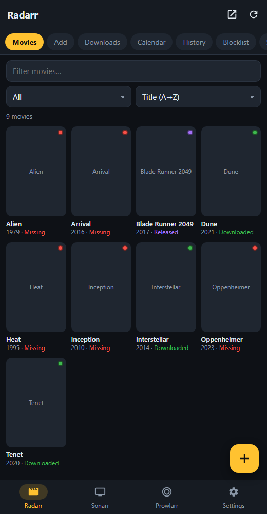
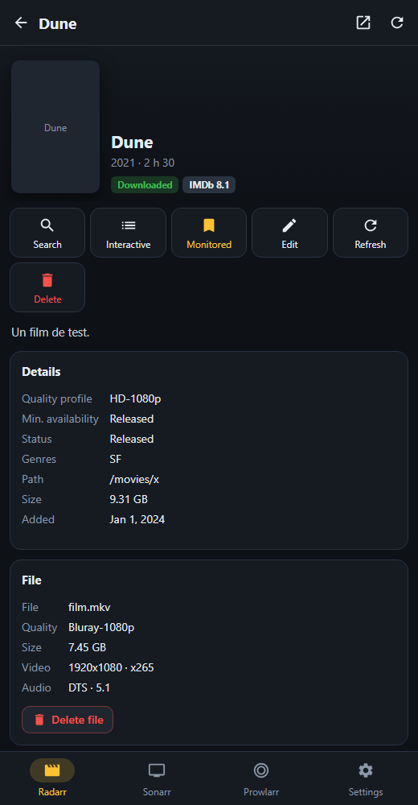
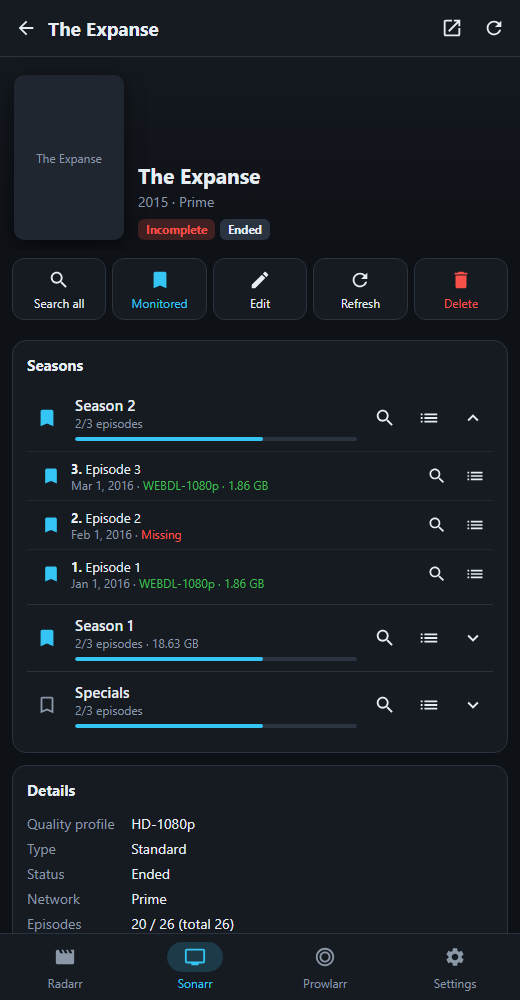
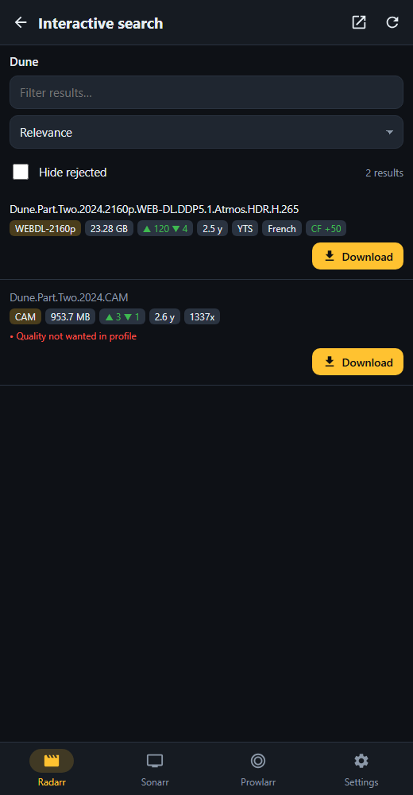

# Arr Manager

A lightweight Android app to control **Radarr**, **Sonarr** and **Prowlarr** from your phone: add movies and series, start downloads, pick releases by hand, watch your download queue, manage indexers, and more.

The app is available in **English** and **French**. It follows your phone's language by default, and you can change it in Settings.

<p>
  
  
  
  
</p>

## Features

**Radarr**
- Poster grid library with filters (missing, downloaded, upcoming…) and sorting
- Add movies with root folder, quality profile, minimum availability, and an option to search right away
- Movie page: automatic search, **interactive search** where you pick the release yourself, monitor/unmonitor, edit, refresh, delete the movie and/or its file, history

**Sonarr**
- Everything above, for series
- Monitor and search **per season** and **per episode**, including interactive search for season packs
- "Wanted" tab listing missing episodes, with a search-all button

**Prowlarr**
- Search across all indexers, then send results straight to your download client or copy the magnet link
- Indexers: enable/disable, test, delete; statistics; linked applications and sync

**Shared**
- Live download queue (remove, blocklist, force), calendar, history, blocklist
- Health checks, disk space, scheduled tasks, logs, backup, restart
- One tap to open each service's **full web interface** inside the app, for advanced settings

## Installation

1. Download the latest `ArrManager-x.y.z.apk` from the [Releases](../../releases) page.
2. Open it on your phone (Android 8.0 or later) and allow installing apps from this source.
3. In the **Settings** tab, enter for each service:
   - its **URL**, e.g. `http://192.168.1.10:7878` (Radarr), `:8989` (Sonarr), `:9696` (Prowlarr)
   - its **API key**, found under *Settings › General › Security › API Key*
4. Tap **Test connection**.

To use the app away from home, you need a URL your phone can reach, such as a VPN (WireGuard, Tailscale…) or a reverse proxy. If a service is served under a sub-path, enter the full URL, e.g. `https://example.com/radarr`.

## Privacy

- No telemetry, no account, no third-party server: the app only talks to **your own servers**.
- URLs and API keys are stored locally on the phone and excluded from Android cloud backups.
- Posters are loaded from the URLs your servers provide (usually TMDB/TheTVDB).
- The "Accept self-signed HTTPS certificates" option turns off TLS verification. Only enable it for your own servers.

## Building from source

The project doesn't use Gradle. The APK is built directly with the Android SDK tools (`aapt2`, `javac`, `d8`, `zipalign`, `apksigner`), and the result is about 50 KB.

Requirements: JDK 17+, and an Android SDK with `platforms;android-34` and `build-tools;34.0.0`.

```bash
# Linux / macOS
export ANDROID_HOME=/path/to/android-sdk
./build.sh
```

```powershell
# Windows
$env:ANDROID_HOME = "C:\path\to\android-sdk"
$env:JAVA_HOME    = "C:\path\to\jdk-17"
.\build.ps1
```

Without a configured key, the APK is signed with a throwaway debug key. To sign with your own key, set `ARR_KEYSTORE`, `ARR_KEYSTORE_PASSWORD`, `ARR_KEY_ALIAS` and `ARR_KEY_PASSWORD`.

### Project layout

```
AndroidManifest.xml
src/com/arrmanager/app/   MainActivity (WebView + native HTTP bridge), WebActivity (full web interface)
assets/                   index.html, style.css, app.js: the whole UI
res/                      app icon
build.sh / build.ps1      build scripts
```

The UI is a bundled HTML/JS page. API calls go through native code (`HttpURLConnection`), which avoids CORS issues and allows plain HTTP on your local network. All UI strings live in `assets/app.js` as `L('français', 'English')` pairs, so adding or fixing a translation is a one-line change.

## Releasing (maintainers)

The GitHub Actions workflow builds the APK on every push. Pushing a `vX.Y.Z` tag also creates a Release with the APK attached:

```bash
git tag v1.1.0
git push origin v1.1.0
```

For updates to install over previous versions, every release must be signed with **the same key**. Store it in the repository secrets (*Settings › Secrets and variables › Actions*):

| Secret | Value |
|---|---|
| `KEYSTORE_BASE64` | the `.jks` file, base64-encoded |
| `KEYSTORE_PASSWORD` | keystore password |
| `KEY_ALIAS` | key alias |
| `KEY_PASSWORD` | key password |

To create and encode a key:

```bash
keytool -genkeypair -keystore release.jks -alias arr -keyalg RSA -keysize 2048 -validity 10000
base64 -w0 release.jks        # Linux
# Windows (PowerShell): [Convert]::ToBase64String([IO.File]::ReadAllBytes("release.jks"))
```

Never commit the `.jks` file. It is already listed in `.gitignore`.

## Disclaimer

This is an independent project, **not affiliated** with the Radarr, Sonarr or Prowlarr teams. Those names belong to their respective projects, and this app only uses their public APIs. Only use it to manage content you have the right to download.

## License

[MIT](LICENSE)
